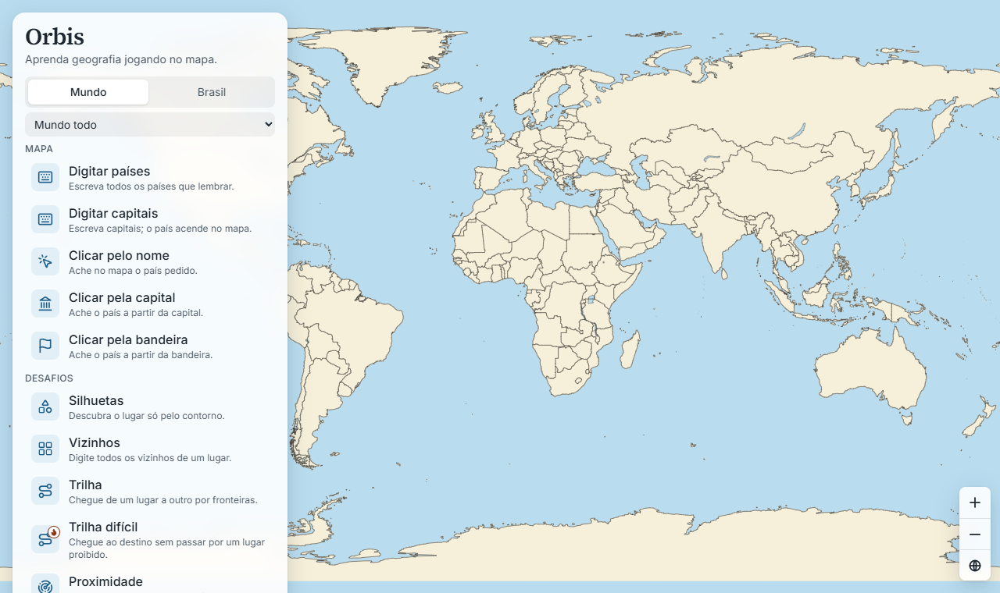
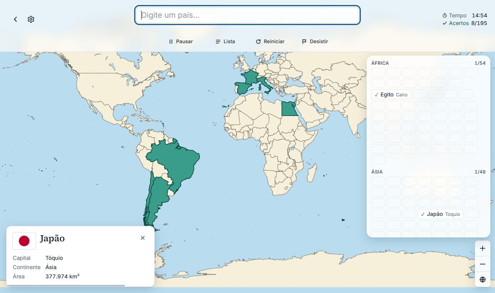
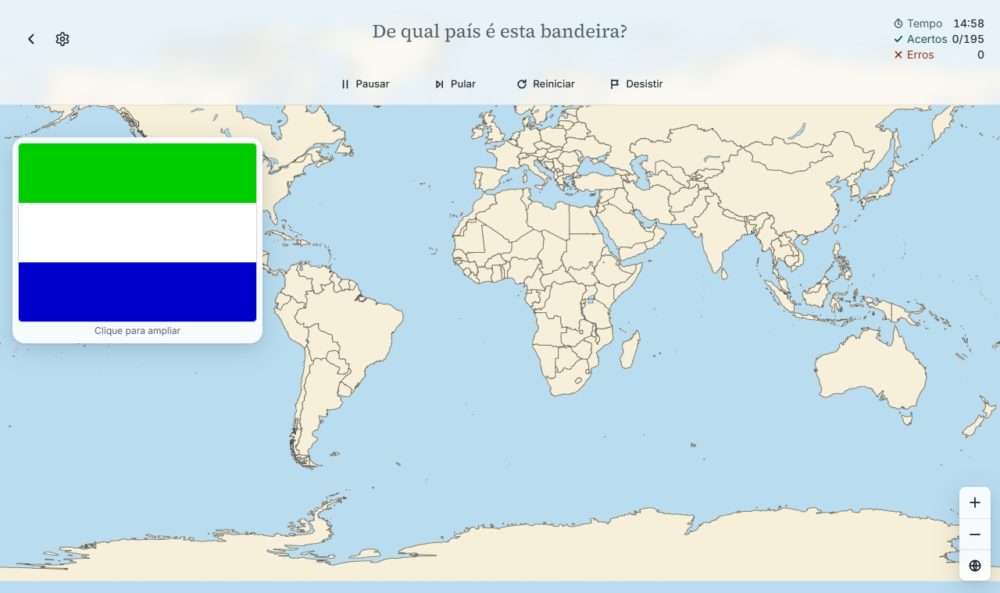
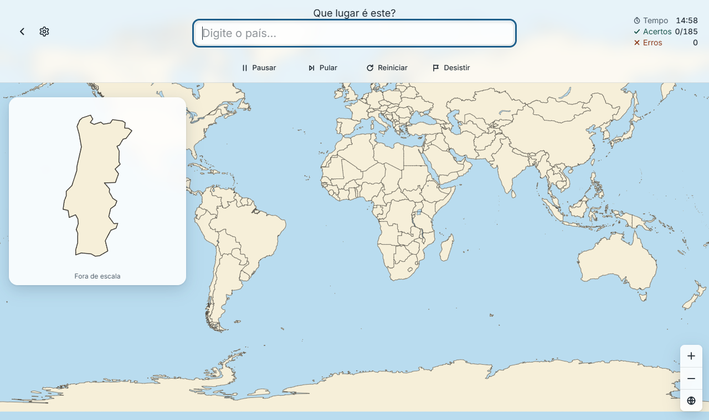
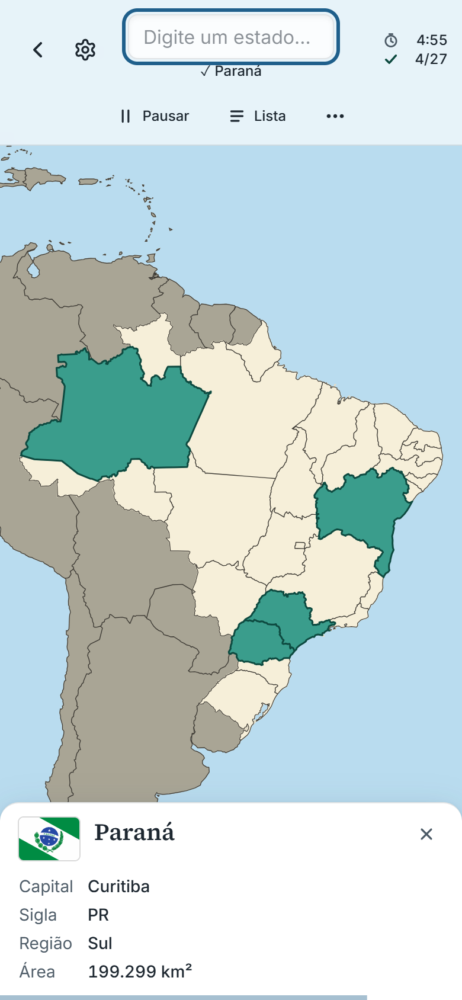

# Orbis

**Jogue agora: <https://orbis-geography.vercel.app>**

Minigames didáticos de geografia para aprender e se desafiar: países, capitais, bandeiras, territórios e os estados e capitais do Brasil. O mapa é o protagonista: ao acertar, você aprende de passagem outras informações do lugar (a capital, a bandeira, o continente, a área).

O site é 100% estático: sem backend, sem banco e sem contas. Tudo o que o jogador salva (configurações, partida em andamento, recordes) fica no `localStorage` do próprio navegador.

|                  Menu (desktop)                  |               Digitar países                |
| :----------------------------------------------: | :-----------------------------------------: |
|  |  |

|           Clicar pela bandeira            |               Desafio: Silhuetas                |
| :---------------------------------------: | :---------------------------------------------: |
|  |  |

|                                     Brasil no celular                                     |
| :---------------------------------------------------------------------------------------: |
|  |

## O que tem

- **Mapas:** Mundo (195 países, com a opção de incluir territórios) e Brasil (26 estados + Distrito Federal).
- **Por continente:** no Mundo, joga-se o mundo todo ou um continente; o mapa enquadra a região escolhida.
- **Nove jogos em cada mapa, em dois grupos:**
  - **Mapa:** digitar países (ou estados), digitar capitais, clicar pelo nome, clicar pela capital e clicar pela bandeira.
  - **Desafios:** Silhuetas, Vizinhos, Trilha (níveis Fácil, Médio e Difícil) e Proximidade.
- **Português e inglês**, com troca na hora; ao digitar valem os dois idiomas.
- **Celular como prioridade:** zoom por pinça, toque duplo para aproximar, áreas de toque ampliadas para microestados e ilhas e menu com abas "Mapa" e "Desafios" para cobrir pouco do mapa.
- **Câmera:** ao revelar uma resposta, começar uma rodada do Vizinhos ou tocar num item de lista, o mapa vai suavemente até o lugar (salta direto com "movimento reduzido"). Nunca se move sozinho a cada acerto no jogo de digitar.
- **Fora da região:** o que está fora do continente escolhido (ou, no Brasil, os países vizinhos) fica num tom apagado, sem destaque nem clique.
- **Bandeiras:** a pista do jogo de clicar pela bandeira é um cartão flutuante; tocar ou clicar numa bandeira a amplia.
- **Proximidade:** escala de uma cor, do amarelo-dourado (longe, escurecido para não se confundir com a cor da terra) ao vermelho-escuro (perto), com contorno em todo lugar chutado e legenda no canto. O contorno fica só na parte principal do lugar (a mesma regra do enquadramento da câmera): ilhas e territórios distantes continuam pintados, sem contorno.
- **Trilha:** chutes em verde, laranja e vermelho, diferentes também na claridade (testados com simulação de protanopia e deuteranopia), cada um com seu ícone na lista (✓, ~, ✗) e seu contorno no mapa (contínuo, tracejado, pontilhado); origem e destino em azul.
- **Dificuldade:** ao clicar num jogo abre uma janelinha com Fácil, Médio, Difícil e Personalizar (os itens de cada nível naquele jogo, com ícone, e o recorde do nível); com partida salva, também Continuar partida. Personalizar mostra só as opções daquele jogo.
- **Configurações:** preferências gerais: idioma, tipo de mapa, câmera, territórios e sons (gerados por código).
- **Aba Sobre** dentro do site, com fontes, critérios e habilidades da BNCC.

## Requisitos

- Node.js `^22.22.3`, `^24.15.0` ou `>=26.0.0` (exigido pelo Angular 22; também declarado em `engines` no `package.json`)
- npm 8 ou superior

## Comandos

```bash
npm install                # instala as dependências
npm start                  # servidor de desenvolvimento em http://localhost:4200
npm run build              # build de produção em dist/orbis
npm run lint               # ESLint
npm test -- --watch=false  # testes, uma execução só (sem o --watch=false ficam em modo observação)
npm run format             # formata tudo com Prettier
npm run format:check       # só verifica a formatação
npm run data               # regenera public/data a partir das fontes abertas (usa o cache em scripts/.cache)
npm run data -- --refresh  # idem, baixando tudo de novo (precisa de internet)
npm run data:proximity     # recalcula só vizinhos e distâncias a partir dos mapas já gerados
```

Depois de regenerar os dados, confira o relatório `scripts/data-report.md` (contagens e casos duvidosos) e rode os testes, que validam os arquivos gerados.

## Como funciona

- **Angular 22** (componentes standalone, signals, rotas carregadas sob demanda, TypeScript estrito) e **Tailwind CSS v4**.
- **Mapas:** D3 (`d3-geo`, `d3-geo-projection`) e TopoJSON, desenhados em SVG. Nunca Mercator, que distorce as áreas.
  - Mundo **contínuo** (padrão): projeção Patterson, que se repete na horizontal, então dá para arrastar para leste ou oeste sem fim.
  - Mundo **arredondado**: projeção Natural Earth, o mapa-múndi clássico. A escolha fica nas configurações.
  - **Brasil:** projeção cônica de áreas iguais, com o enquadramento calculado a partir da geometria dos estados e os países vizinhos só como contexto. Os arquivos do Brasil só são baixados quando essa camada é usada.
- **Um jogo = camada de mapa + tipo de pista + tipo de resposta.** Mapa, moldura de jogo (tempo, placar, progresso, pausa, desistir, reiniciar, tela final), cartão de informações e painel de configurações são compartilhados por todos os jogos.
- **Idiomas:** tradução em tempo de execução (a i18n nativa do Angular gera um build por idioma). Textos da interface em `src/app/core/i18n/strings.ts`; nomes de lugares vêm dos dados, já em português e inglês.
- **Salvamento local:** um F5 retoma a partida de onde parou (pausada) e o melhor resultado de cada jogo fica guardado, por mapa e por continente.

### Jogos do grupo Mapa

- **Digitar** (países/estados e capitais): digite o máximo possível antes de o tempo acabar. Acertos acendem no mapa e na lista por continente (ou região do Brasil). Vale português ou inglês, sem se preocupar com acentos, maiúsculas, hífens ou espaços.
  - O nome (ou apelido) inteiro e exato conta na hora. Se ele também é o começo do nome de outro lugar ainda não acertado ("Irã" → "Iraque"), confirme com **Enter**. O Enter também perdoa erros leves de grafia, mas recusa se o erro servir para dois lugares (Gâmbia/Zâmbia).
- **Clicar** (nome, capital ou bandeira): a pergunta fica na barra superior e você clica no lugar certo. Há placar de acertos e erros, botão **Pular**, modo aprender (ao errar mostra o lugar clicado) e revelação da resposta ao esgotar as N tentativas por pergunta (1, 2, 3 ou 5; vale como erro).
- Pausar, Reiniciar e Desistir ficam sempre na barra superior; sair com progresso pede confirmação.

### Desafios

Todos se respondem digitando (menos as Silhuetas no Fácil, com alternativas), com a mesma regra dos jogos de digitar (dois idiomas, Enter para confirmar e perdoar grafia). Digitar um lugar que não é alvo (Groenlândia, Inglaterra...) não custa nada: o jogo explica o porquê. No mapa do Brasil, todos usam os estados.

- **Silhuetas:** descubra o país (ou estado) pelo contorno; o modo muda com a dificuldade (configuração "Modo das Silhuetas"):
  - **Fácil (alternativas):** 4 nomes, do mesmo continente (ou região) e de tamanho parecido; onde faltam lugares, completam os mais próximos. Vale clicar ou usar as teclas 1 a 4. A silhueta já aparece com os **arredores**: um recorte do mapa, com os lugares em volta só em contorno cinza, sem nomes.
  - **Médio (com dicas):** digite o nome; o continente (ou a região) aparece na pergunta e o botão **Dica** revela, em ordem e cada uma no seu cartão, os arredores, os vizinhos (ou os dois lugares mais próximos, sem fronteira terrestre) e a primeira letra com o número de letras. As dicas aparecem sob o título "DICAS", cada uma com o título em negrito (e ícone) e a resposta embaixo (ex.: "Letra S, 8 letras"). No recorde, com os mesmos acertos, vence a partida que usou dica em menos perguntas.
  - **Difícil (sem dicas):** só o contorno, sozinho, grande e **fora de escala**, numa projeção centrada nele.

  Nos três modos, o mapa mostra só o litoral, sem fronteiras; acertados e revelados aparecem com o contorno deles.

  O contorno é só a terra do próprio lugar: a Dinamarca aparece sem a Groenlândia e a França sem a Guiana Francesa; com territórios ligados, cada território tem a própria silhueta. Ilhas muito pequenas em relação à parte principal ficam de fora (o Havaí, as Canárias). Lugares cujo contorno é degenerado na resolução dos mapas não são sorteados (veja abaixo), e o total da partida já desconta esses lugares. Errar com outro lugar real conta erro. Pular, revelar ao esgotar as tentativas e modo aprender funcionam como nos jogos de clicar. Ao acertar, o lugar acende no mapa e o cartão abre.

- **Vizinhos:** um lugar fica destacado no mapa e você digita todos os vizinhos terrestres dele; cada acerto acende. **Desistir da rodada** mostra os que faltaram (em terracota). São 10 rodadas (menos, se a região tiver menos lugares com vizinhos); o placar soma os vizinhos acertados.
- **Trilha:** origem e destino já vêm dados (do continente escolhido, ligados por terra, caminho mínimo de 3 a 8 passos). Digite, em qualquer ordem, os lugares que os ligam: você vence quando os chutes, junto com origem e destino, contêm um caminho ligado de um ao outro (de qualquer tamanho) e perde se os chutes acabarem antes. Todo lugar real digitado pela primeira vez gasta um chute, inclusive ilhas e proibidos; repetir, digitar a origem ou o destino, texto que não é lugar e lugares que não são alvo não gastam. A barra mostra desde o início quantos passos tem o caminho mínimo.
  - **Cores**, calculadas pelo total de chutes da partida (nunca mudam durante o jogo): **verde ✓** se o lugar está num caminho mínimo; **laranja ~** se há um caminho da origem ao destino passando por ele, sem repetir lugar, cujo número de lugares intermediários cabe no total de chutes; **vermelho ✗** nos demais (ilhas, lugares sem ligação por terra, becos sem saída e os proibidos). Tudo é calculado evitando os proibidos.
  - **Níveis** (configuração "Nível da Trilha", ajustada pela dificuldade escolhida ao começar): **Fácil** mostra o mapa com fronteiras; **Médio** esconde o mapa (só aparecem a água, a origem, o destino e os chutes, todos com o nome escrito); **Difícil** também esconde o mapa e dá menos chutes. Chutes: passos mínimos, já contornando os proibidos, + 4 (Fácil e Médio) ou + 2 (Difícil).
  - **Proibidos** (configuração "Proibidos na Trilha"): lugares por onde a trilha não pode passar, mostrados desde o início. Nenhum no Fácil, às vezes 1 no Médio (cerca de um terço das partidas), de 1 a 3 no Difícil.
  - **Travessias entre ilhas** (opção, só no Mundo): a trilha também passa por mar entre uma ilha e os lugares a até 300 km de litoral a litoral (ou o mais próximo, se não houver nenhum). Duas massas continentais nunca se ligam por mar. Com os territórios desligados, a distância é medida só pela terra do próprio país (Gibraltar, Porto Rico e outros territórios não contam). Com ela, a Oceania fica jogável e os recordes são separados.
  - **Variedade:** toda origem possível tem a mesma chance; os últimos 15 pares e o lugar central inevitável da partida anterior são evitados.
  - **Dicas** (sem limite e sem gastar chute): **Próximo contorno** mostra só o contorno de um lugar que falta num caminho mínimo (no caminho que aproveita os verdes já chutados, o lugar colado à parte já ligada à origem ou, se não houver, à ligada ao destino); **Revelar mapa** (Médio e Difícil) mostra o mapa inteiro até o fim. No celular, as dicas ficam no menu "⋯". Usar dica marca a partida "com dica".
  - **Fim:** o mapa inteiro aparece, com o caminho do jogador preenchido, cada lugar do caminho numerado numa etiqueta com o nome (origem = 1, na cor do ponto do lugar na linha do tempo) e, no painel, uma linha do tempo vertical da origem ao destino (trechos por mar ondulados). Passar o mouse num lugar da linha do tempo o destaca no mapa. Com desvio, o painel compara os passos e um caminho mínimo pode ser aberto (segunda linha do tempo; o mapa passa a numerar e pintar de verde o mínimo e apaga os lugares só do seu caminho). Ao desistir ("Você desistiu", sem chutes nem tempo) ou ficar sem chutes ("Seus chutes acabaram", com chutes e tempo), aparece "Uma solução possível". Entre dois números ligados por mar, o mapa mantém a linha da travessia. A legenda fica no botão "i".
  - **Recordes** separados por nível; uma partida sem dica sempre vence uma com dica e, entre iguais, vence a de menos chutes.
- **Proximidade:** ache um lugar secreto. Cada chute ganha uma cor de quente (perto) a frio (longe) no mapa. No Fácil também aparecem a distância e uma seta com a direção; no Médio, só a distância; no Difícil, só a cor, com um rótulo em palavras (de "fervendo" a "gelado"). A lista de chutes (botão **Chutes**) fica ordenada do mais perto ao mais longe nos três níveis, com o melhor destacado no topo. Sem limite de chutes; o recorde é achar com menos chutes.

Na Trilha e na Proximidade o cronômetro só conta para cima. O Vizinhos fica desabilitado no menu numa região sem fronteiras terrestres suficientes (por exemplo, na Oceania), com uma explicação curta; a Trilha, lá, pede que se liguem as travessias na janelinha. Onde nenhum lugar pode ser proibido (na América do Norte, sem travessias), a Trilha roda sem proibidos, com um aviso na janelinha de início. Na Trilha, origem e destino mostram o nome sempre; os demais lugares seguem a mesma regra por área dos "nomes no mapa" (os pequenos só com zoom).

### Configurações

Menu → **Configurações** (engrenagem): idioma, projeção do mapa, câmera, territórios e sons. As opções de dificuldade ficam em "Personalizar", na janelinha de início de cada jogo, que mostra só as que aquele jogo usa. Tudo é salvo só neste navegador; uma partida em andamento mantém as regras de quando começou.

| Opção                       | Fácil               | Médio                       | Difícil                     |
| --------------------------- | ------------------- | --------------------------- | --------------------------- |
| Cronômetro                  | desligado           | 15 min Mundo / 5 min Brasil | 10 min Mundo / 3 min Brasil |
| Cronômetro (digitar)        | desligado           | 15 min Mundo / 5 min Brasil | 15 min Mundo / 5 min Brasil |
| Fronteiras no mapa          | todas               | todas                       | só o litoral                |
| Tolerância de grafia        | alta                | normal                      | nenhuma                     |
| Cartão de informações       | sim                 | sim                         | não                         |
| Modo aprender               | sim                 | sim                         | não                         |
| Tentativas por pergunta     | 3                   | 3                           | 1                           |
| Destaque ao passar o mouse  | sim                 | sim                         | não                         |
| Nomes dos acertados no mapa | sim                 | não                         | não                         |
| Nível da Trilha             | Fácil               | Médio                       | Difícil                     |
| Proibidos na Trilha         | nenhum              | às vezes                    | sempre                      |
| Modo das Silhuetas          | alternativas        | com dicas                   | sem dicas                   |
| Pistas da Proximidade       | distância e direção | só distância                | só cor                      |

Os três níveis acima são os valores que a janelinha de início aplica. "Fronteiras no mapa" vale para Digitar países, Digitar capitais e Vizinhos (as Silhuetas usam sempre só o litoral): com só o litoral, a terra aparece inteira e cada acerto surge no lugar certo. Os recordes são por jogo, mapa, continente e nível (Fácil, Médio, Difícil ou Personalizado; este também por todas as opções que o jogo usa; na Trilha, também com ou sem travessias). O nível é o do começo da partida, mesmo que as configurações mudem no meio. Idioma, projeção do mapa, **Sons**, **Incluir territórios** e **Travessias entre ilhas** (desligados por padrão) são preferências à parte e não mudam com o nível; as travessias ficam na janelinha da Trilha. No mapa do Brasil a opção de territórios fica desativada, com uma explicação, porque lá os alvos são só os estados.

## Critérios de países e territórios

- **Países:** os 193 membros da ONU + Vaticano + Palestina (observadores) = 195.
- **Territórios e regiões:** áreas com código ISO 3166-1 próprio que não são um dos 195 (Groenlândia, Guiana Francesa, Malvinas, Antártida...), mais Kosovo, Somalilândia e Chipre do Norte.
  - Opção **desligada** (padrão): só os 195 países são alvos e cada território conta como parte do país que o administra (clicar na Groenlândia = clicar na Dinamarca). A Antártida e as áreas que nenhum país administra aparecem no mapa, mas não são alvo.
  - Opção **ligada**: os territórios viram alvos próprios (inclusive a Antártida) e o total passa de 195.
- **Áreas disputadas:** ficam com o país que as administra hoje, e a cartão de informações menciona a disputa (por exemplo, Malvinas).
- **Exceção:** Kosovo, Somalilândia, Chipre do Norte e Taiwan se governam de forma independente, mas têm reconhecimento contestado; o Saara Ocidental tem status ainda indefinido na ONU. Por isso nenhum deles conta como parte de outro país: com a opção de territórios desligada não são alvo; ligada, viram alvos próprios, e a cartão explica o status de cada um.
- **Mais de uma capital** (Bolívia, África do Sul...): qualquer uma é aceita e todas são mostradas.
- **Nomes repetidos** entre territórios levam o país administrador entre parênteses, por exemplo "São Martinho (França)".
- **Brasil:** 26 estados + Distrito Federal, agrupados nas cinco regiões do IBGE.
- Cada exceção e sua justificativa estão em [scripts/decisions.json](scripts/decisions.json).

## Lugares fora das Silhuetas

O script de dados mede o contorno de cada lugar e deixa de fora os que ficam degenerados na resolução do mapa: **menos de 1 km²** de área (um ponto, não uma forma) ou **menos de 5 pontos** no contorno (um triângulo ou um quadrado não se reconhece). Eles não são sorteados, mas continuam valendo como resposta digitada e aparecem no mapa. A lista e as medidas ficam em `public/data/silhouette-excluded.json` e em `scripts/data-report.md`; hoje são, sem nenhum estado do Brasil:

- **Países (10), com territórios desligados:** Andorra, Barbados, Dominica, Liechtenstein, Mônaco, Nauru, San Marino, Santa Lúcia, Singapura e Vaticano.
- **Territórios (14, só com a opção ligada):** Aruba, Gibraltar, Guam, Ilha Bouvet, Ilha Christmas, Ilha de Man, Ilha Heard e Ilhas McDonald, Ilha Norfolk, Jersey, Montserrat, Niue, São Bartolomeu e as duas partes de São Martinho.

O Vaticano tem área zero no mapa (contorno de 2 pontos); os demais têm 3 ou 4 pontos. A lista muda sozinha se os mapas forem regenerados com outra resolução.

## Critérios de vizinhança e distância

- **Vizinhos:** só fronteira terrestre. Dois lugares são vizinhos quando compartilham um trecho de borda no mapa; encostar num ponto só (como no encontro de quatro países) não conta. Um lugar dentro de outro conta (Vaticano e Itália).
- **Territórios:** com a opção desligada, o território vale como o país que o administra, então a França faz fronteira com o Brasil pela Guiana Francesa, e o jogo explica isso ao acertar. Ligada, o território tem vizinhos próprios.
- **Na Trilha**, uma fronteira que só existe por um território vale apenas se ele estiver no mesmo continente do país que o administra: Gibraltar vale; Guiana Francesa, Saint-Martin e as bases britânicas em Chipre não. Por isso, na Trilha, a França não é vizinha do Brasil.
- **Fronteiras que a simplificação do mapa apaga** e foram repostas à mão: Espanha–Marrocos (Ceuta e Melilla), Botswana–Zâmbia (Kazungula) e Macau–China.
- **Distâncias (Proximidade):** a menor distância entre as bordas dos dois lugares, medida sobre a superfície da Terra a partir das fronteiras simplificadas do mapa. Com os territórios desligados, só conta a terra do próprio país (as Ilhas Virgens não aproximam o Reino Unido dos EUA; a Sicília e o Havaí contam); fronteiras terrestres por território seguem como vizinhança. São **aproximadas** (erro de algumas dezenas de km), por isso aparecem arredondadas para dezenas de km ("≈ 10 km" no mínimo); vizinhos aparecem como "vizinho". A seta aponta do lugar chutado para o secreto (entre os pontos onde os nomes ficam no mapa), em 16 pontos da bússola.
- Os cálculos são feitos por `npm run data` (arquivos em `public/data/`); detalhes em [DATA_SOURCES.md](DATA_SOURCES.md).

## Fontes dos dados

Os dados geográficos em `public/data/` são gerados por `npm run data` a partir de bases abertas (Natural Earth, Wikidata, IBGE, flag-icons e Wikimedia Commons). Fontes, versões e licenças de cada dado estão em [DATA_SOURCES.md](DATA_SOURCES.md).

## Estrutura

- `src/app/core/`: serviços e lógica compartilhada (dados, i18n, configurações, regras dos jogos, salvamento, recordes, sons)
- `src/app/shared/`: componentes reutilizáveis (mapa, moldura de jogo, cartão, configurações, barra superior)
- `src/app/pages/`: páginas, carregadas sob demanda (menu, jogos de digitar e de clicar, Silhuetas, Vizinhos, Trilha, Proximidade, Sobre)
- `public/data/`: dados estáticos gerados (não editar à mão)
- `scripts/`: script que gera os dados (`build-data.mjs`, com vizinhos e distâncias em `proximity.mjs`) e as decisões editoriais (`decisions.json`)
